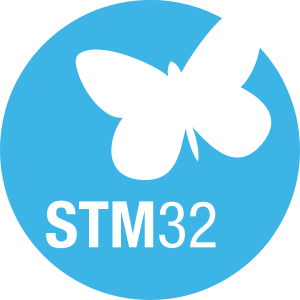

# __Example: *example_oemirot_singleslot_hwcrypto*__

**Example version:** 2.0.2

How to implement an __OEMiRoT__ boot stage in single-slot mode, relying on hardware cryptography.

OEMiRoT stands for *OEM immutable Root of Trust*. Its services include:

- __Secure Boot__: Verifies the integrity and authenticity of the application firmware before execution.
- __Secure Firmware Update__: Verifies and installs new encrypted firmware images when a download slot is configured.

Single-slot mode uses only the primary application slot. The primary slot and OEMiRoT fit
within one 256-KB flash bank; the other bank remains unused. Since there is no secondary
slot, this example does not generate a firmware-update image.

The example uses overwrite installation mode. Swap mode requires a secondary slot and is not
available in this single-slot layout.

OEMiRoT security relies on cryptography for integrity, authenticity, and confidentiality.
However, the use of cryptography alone is insufficient. A set of hardware and software security measures
are included in the OEMiRoT to protect critical operations and sensitive data (such as a secret key).

The core function of OEMiRoT relies on the MCUboot middleware. \
The cryptography functions rely on the STFCF middleware, using the HASH peripheral, the PKA peripheral and the SAES peripheral.


## __1. Overview__

This example contains two projects:

- **OEMiRoT**: Handles secure boot.
- **User application**: The main firmware image to protect.

This single-slot example does not provide in-application firmware updates.

Supporting Python scripts include:

- `provisioning.py`: Guides the user through configuration, build, and programming steps.
- `project_appli.py`: Automates prebuild/postbuild steps.
- `project_oemirot.py`: Automates prebuild steps.


## __2. Requirements__

- Python 3.10 or later
- STM32CubeProgrammer (with STM32TrustedPackageCreator)
- Required Python modules:
  ```bash
  pip install -r requirements.txt
  ```


## __3. Quickstart__

<details open>
  <summary>On STM32G5 series.</summary>

Follow [How to start with OEMiRoT on STM32G5](https://wiki.st.com/stm32mcu/wiki/Security:How_to_start_with_OEMiRoT_on_STM32G5)
</details>


## __4. Known limitations__

None


## __5. See Also__

<details open>
  <summary>On STM32G5 series.</summary>

More information about OEMiRoT can be found in [OEMiRoT for STM32G5](https://wiki.st.com/stm32mcu/wiki/Security:OEMiRoT_for_STM32G5)
</details>


## __6. License__

Copyright (c) 2026 STMicroelectronics.

This software is licensed under terms that can be found in the LICENSE file in the root directory of this software component.
If no LICENSE file comes with this software, it is provided AS-IS.
