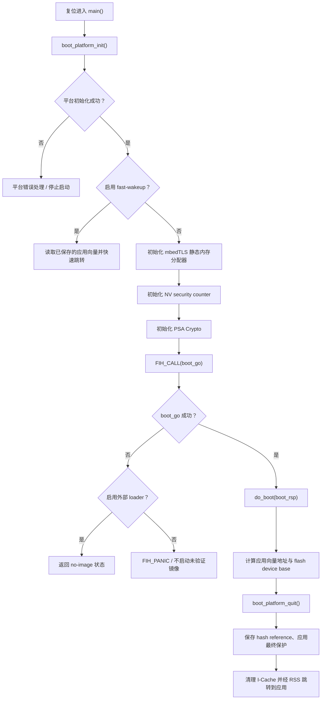
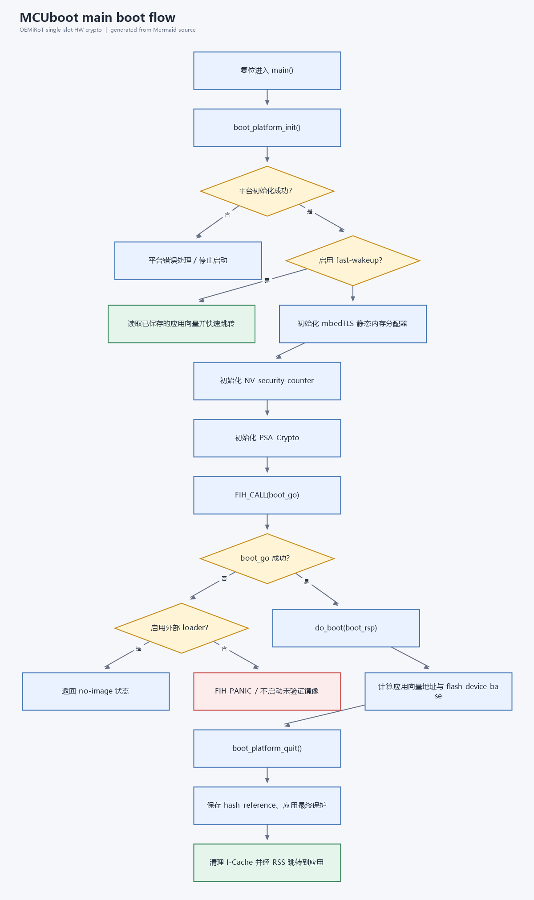
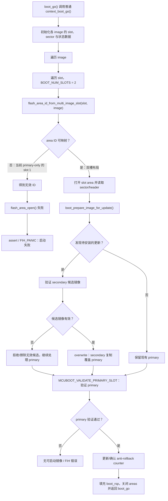
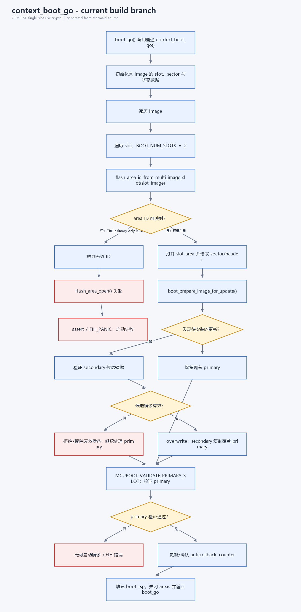
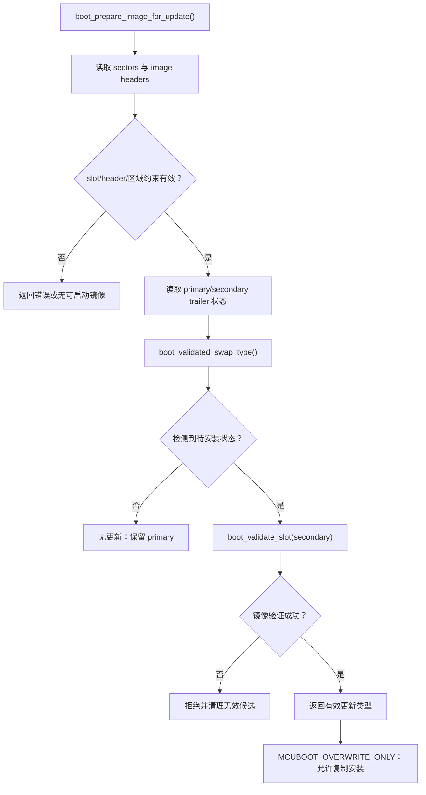
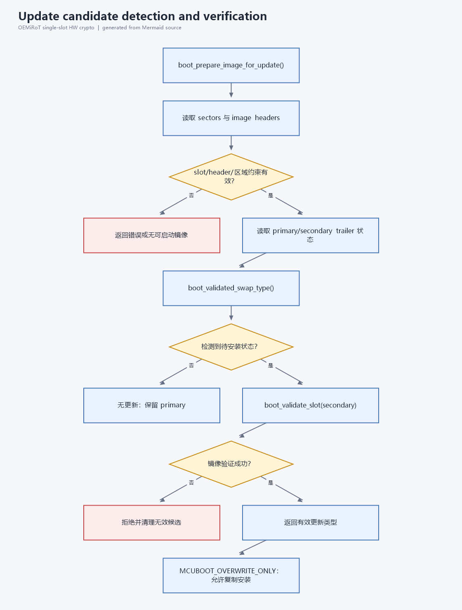
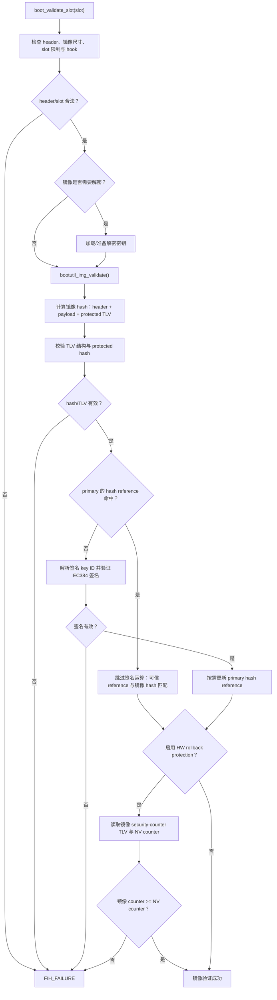
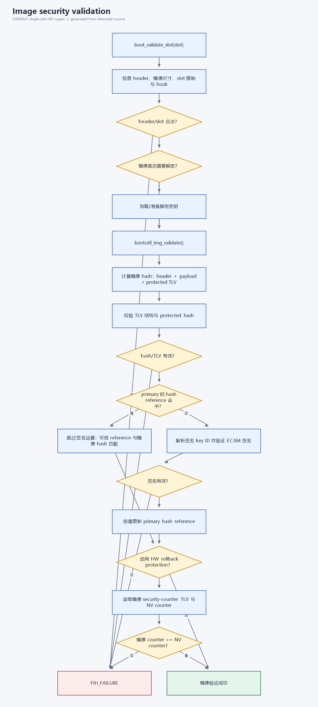
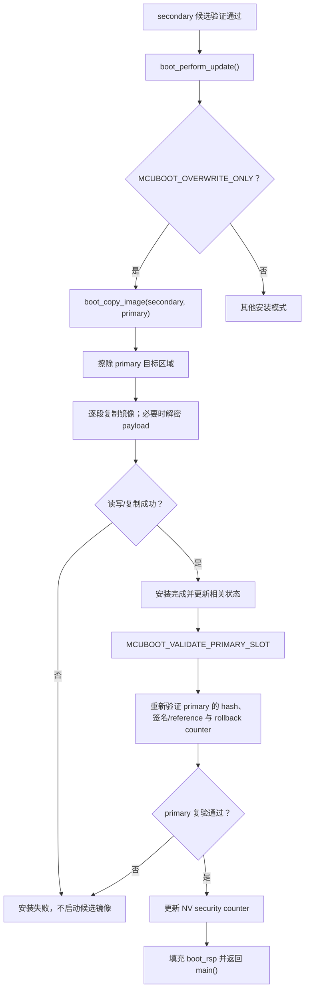
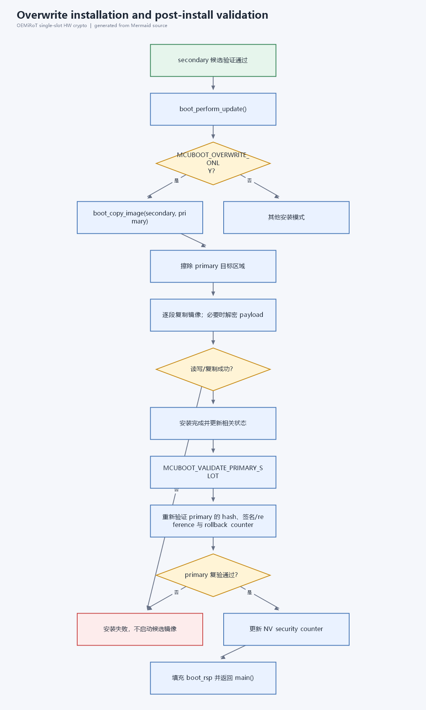

# MCUboot 安全启动与升级验证流程

本文按当前 `oemirot_singleslot_hwcrypto` 配置梳理 MCUboot 的启动、镜像验证和 overwrite 更新流程。每张流程图同时提供 Mermaid 源码和 PNG 图片。

## 当前配置与结论

当前工程在 [mcuboot_config.h](../NUCLEO-G564RE/oemirot/mcuboot_config.h) 中启用了 `MCUBOOT_PRIMARY_ONLY`、`MCUBOOT_SINGLE_APPLICATION_SLOT`、`MCUBOOT_OVERWRITE_ONLY`、`MCUBOOT_VALIDATE_PRIMARY_SLOT`、`MCUBOOT_USE_HASH_REF` 和 `MCUBOOT_HW_ROLLBACK_PROT`。工程使用 EC384 签名、EC256 加密、AES-256 和 PSA Crypto；`MCUBOOT_DIRECT_XIP`、`MCUBOOT_RAM_LOAD` 未启用，因此编译的是普通 overwrite/swap 分支中的 `context_boot_go()`，不是 Direct-XIP/RAM-load 分支。

**当前源码存在单槽配置与 loader 行为不一致的问题。** `MCUBOOT_PRIMARY_ONLY` 让 `flash_area_id_from_multi_image_slot()` 不再映射 secondary slot，但 `BOOT_NUM_SLOTS` 仍为 2，普通 `context_boot_go()` 仍按两个 slot 遍历并打开 area。slot 1 的 area ID 无法映射，`flash_area_open()` 失败，loader 随后进入断言/`FIH_PANIC` 路径。也就是说，按当前代码，流程不能到达正常的 primary 验证和启动阶段。

`MCUBOOT_OVERWRITE_ONLY` 只选择“把 secondary 镜像覆盖复制到 primary”的安装方式；它本身不会令 loader 变成单槽，也不会跳过 secondary area。例程没有提供 secondary app 更新镜像时，这个 loader/flash-map 冲突仍需先解决。

## 1. `main()` 启动主流程

入口为 [platform_common/main.c](../../../../../middleware/mcuboot/platform_common/main.c#L96)。平台初始化的关键步骤见目标平台 [boot_hal.c](../NUCLEO-G564RE/oemirot/boot_hal.c#L409)。

`fast-wakeup` 是条件编译路径；当前配置未启用时走完整初始化和 `boot_go()`。平台初始化包括时钟/系统、RNG、PUF、flash、运行时与静态保护，以及读取和验证 HDPL1 OBK 配置、加载 hash references。`boot_platform_quit()` 保存 hash references 并完成跳转前的平台保护操作。

## 2. 当前编译的 `context_boot_go()` 主流程

普通分支位于 [loader.c](../../../../../middleware/mcuboot/boot/bootutil/src/loader.c#L2148)。另一个 `context_boot_go()` 位于同文件 Direct-XIP/RAM-load 条件分支；当前工程不使用它。

图中从“slot 1 无法映射”到 panic 是当前单槽配置的实际阻断点。后续的双槽更新及 primary 验证仅描述 loader 在 area 映射可用时的预期流程，不代表当前单槽工程能执行到这些步骤。

相关实现：

- `BOOT_NUM_SLOTS` 定义仍为 2：[bootutil_priv.h](../../../../../middleware/mcuboot/boot/bootutil/src/bootutil_priv.h#L56)。
- primary-only 下 secondary slot 映射被排除：[flash_map_extended.c](../../../../../middleware/mcuboot/platform_common/flash_map_extended.c#L56)。
- `flash_area_open()` 查不到 area 时返回错误：[flash_map.c](../../../../../middleware/mcuboot/platform_common/flash_map.c#L188)。
- flash area ID/大小来自目标 [flash_layout.h](../NUCLEO-G564RE/oemirot/flash_layout.h#L130)；secondary app slot 配置为空。

## 3. 更新候选识别与验证

`boot_prepare_image_for_update()` 读取 slot 的 sector/header 信息并检查 slot 兼容性，然后结合 trailer 状态判断是否有更新请求。若有候选更新，`boot_validated_swap_type()` 通过 trailer 状态识别操作类型；候选镜像必须先经过 `boot_validate_slot()`。在 overwrite 配置下，验证通过后才允许把 secondary 镜像复制到 primary。

## 4. `boot_validate_slot()` 与镜像安全验证

`boot_validate_slot()` 先检查镜像 header、slot 大小及平台 hook，再进入 `boot_image_check()` / `bootutil_img_validate()`。当前配置启用了加密镜像、签名验证、hash reference 和硬件 rollback protection。

镜像 hash 覆盖 header、payload 和 protected TLV；加密 payload 在参与 hash 前会按配置解密。hash reference 只在 primary slot 的匹配路径起到避免重复签名计算的作用；reference 不匹配或不存在时仍需验证签名。硬件 rollback 检查要求镜像 counter 不低于 NV counter。counter 的初始化/读取/更新由 MCUboot security counter wrapper 调用平台接口，目标平台将值存放在 OBK NV counter 中。

## 5. Overwrite 安装与安装后复验

overwrite 更新并非 swap：`boot_perform_update()` 最终调用 `boot_copy_image()`，把已验证的 secondary 镜像复制到 primary；随后 `MCUBOOT_VALIDATE_PRIMARY_SLOT` 要求再次验证 primary。仅在安装及复验成功后，loader 才准备最终启动响应。

## 6. 主要源码索引

- 入口与跳转：[main.c](../../../../../middleware/mcuboot/platform_common/main.c#L96)、目标平台 [boot_hal.c](../NUCLEO-G564RE/oemirot/boot_hal.c#L409)。
- `boot_go()` 与普通 `context_boot_go()`：[loader.c](../../../../../middleware/mcuboot/boot/bootutil/src/loader.c#L2148)、Direct-XIP/RAM-load 分支 [loader.c](../../../../../middleware/mcuboot/boot/bootutil/src/loader.c#L2589)。
- 更新判定、slot 验证、复制和安装：[loader.c](../../../../../middleware/mcuboot/boot/bootutil/src/loader.c#L1014)、[loader.c](../../../../../middleware/mcuboot/boot/bootutil/src/loader.c#L1394)、[loader.c](../../../../../middleware/mcuboot/boot/bootutil/src/loader.c#L1676)、[loader.c](../../../../../middleware/mcuboot/boot/bootutil/src/loader.c#L1875)。
- hash、TLV、签名与 rollback 检查：[image_validate.c](../../../../../middleware/mcuboot/boot/bootutil/src/image_validate.c#L83)、[image_validate.c](../../../../../middleware/mcuboot/boot/bootutil/src/image_validate.c#L450)、[image_validate.c](../../../../../middleware/mcuboot/boot/bootutil/src/image_validate.c#L677)。
- NV counter wrapper 与目标平台实现：[security_cnt.c](../../../../../middleware/mcuboot/platform_common/security_cnt.c#L29)、[boot_nv_counters.c](../NUCLEO-G564RE/oemirot/boot_nv_counters.c#L39)。
- hash-reference 的平台存取：[boot_hal_hash_ref.c](../NUCLEO-G564RE/oemirot/boot_hal_hash_ref.c#L42)。
